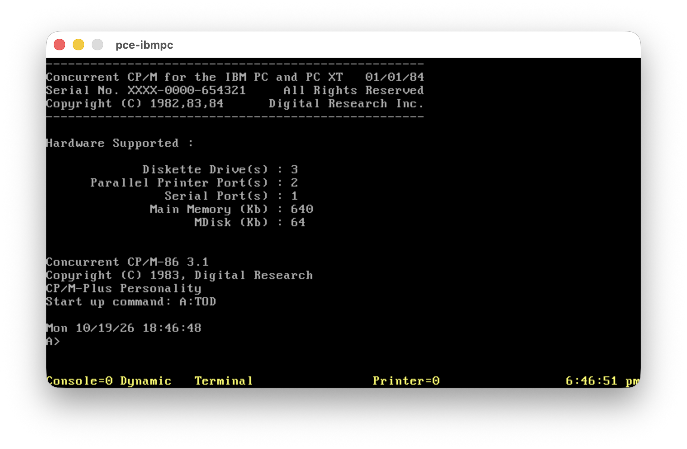
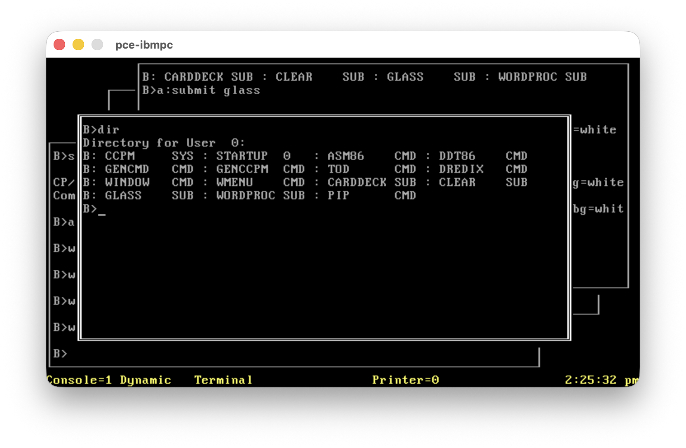
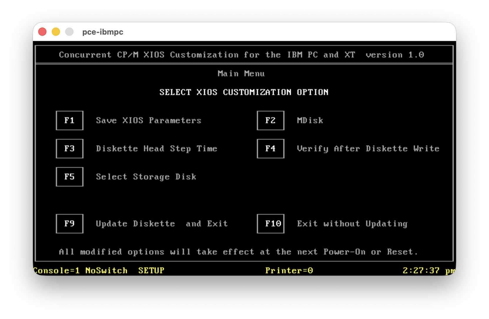
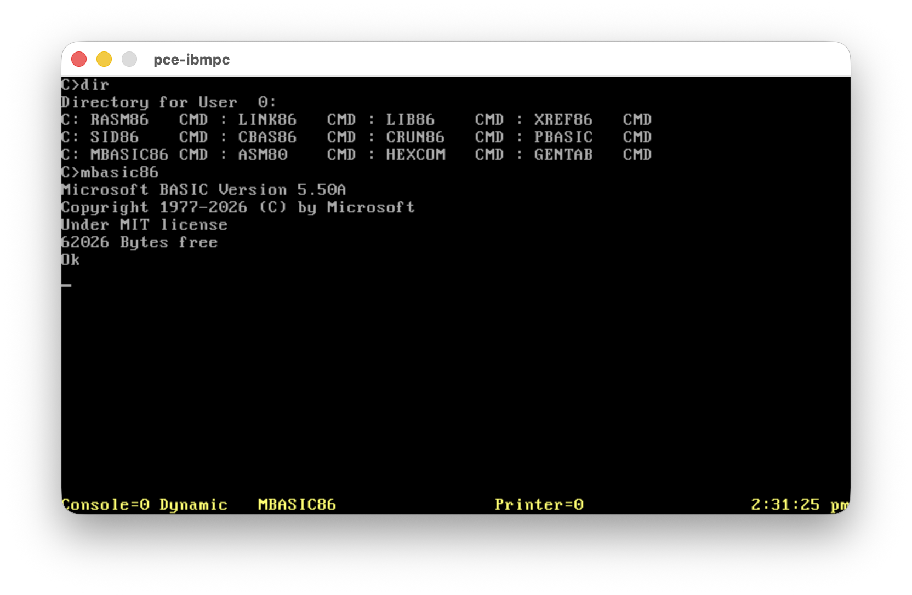

# Concurrent CP/M-86 3.1 Kernel and Tools

**Disk Images are now available as part of the project releases, ready to use !**

This project preserves Digital Research's Concurrent CP/M-86 3.1 as a usable,
rebuildable system for running and exploring classic 16-bit software. Runnable
disks and development tools accompany the sources and patch notes, making the
system more consumable (CP/M-Plus style) and accessible to anyone interested in its history.

<p align="center">


<br><sub>Concurrent CP/M-86 3.1 &nbsp;·&nbsp; Console windows</sub><br>


<br><sub>System setup &nbsp;·&nbsp; Microsoft BASIC 5.50A</sub>
</p>


| Goal | Distribution |
| --- | --- |
| Full source distribution | Kernel, nine RSPs, most commands; gaps below |
| Additional tools | ASM80, HEXCOM, DREDIX, DR development chain, Microsoft BASIC 5.50A |
| Y2K components | SDIR, DATE, SHOW, TOD for CCP/M-86 3.2 through Concurrent DOS 4.1; 3.1 fixes included |

The current version already incorporate:
- CP/M Plus mapped and direction keys command line recall and editing,
- CP/M Plus setdef style configurability
- support for CGA, EGA modes even on VGA card,
- Y2K compliance,
- New terminal commands (cls, sysdisk)

Those little changes make the OS far more friendly than the original.

## Command line conveniences

Buffered console input supports insertion and deletion within a line:

| Key | Action |
| --- | --- |
| Left / Ctrl-A | Move one character left |
| Right / Ctrl-F | Move one character right |
| Home / End | Go to the beginning / end |
| Up / Ctrl-W | Recall the last nonempty line when empty; otherwise go to the end |
| Backspace / Rubout | Delete left of the cursor |
| Delete / Ctrl-G | Delete at the cursor |
| Ctrl-K / Ctrl-X | Delete to the right / left of the cursor |
| Ctrl-B | Go to the beginning, or to the end when already at the beginning |
| Ctrl-U / Ctrl-R | Cancel the line / retype it on a new line |

Return accepts the whole line, even when the cursor is in the middle.
Each console keeps one saved line, including input accepted by applications
using BDOS Function 10; there is no history list. Tabs, displayed control
characters and wrapped rows are handled by the editor. Navigation mappings
apply during buffered line input; raw applications retain their existing keys.
See [PATCHES.md](PATCHES.md) for the precise control-character behavior.

At the shell prompt, `?` lists common commands and `? PIP` opens the existing
HELP topic for PIP. Whitespace is required between `?` and the topic; HELP
must be installed for topic lookup. `?` alone is built into TMP and works
without HELP.CMD. Topic requests may contain at most 125 characters including
the `?`, leaving room for expansion to `HELP` in the 128-character buffer.

Command errors distinguish missing commands, unavailable drives, invalid
names/extensions/password syntax, memory/process limits and malformed or
unreadable CMD files. Unknown errors retain their numeric code. Explicit
drive checks preserve the current drive when the requested drive is unavailable.

`SETDEF` configures command searching independently for each console:

```text
SETDEF             Display the current settings
SETDEF *           Reset the drive list to current drive
SETDEF *,A:,C:     Search current drive, A:, then C:
SETDEF M:,*        Prefer utilities on the memory disk
SETDEF [ORDER=(CMD,SUB)]  Enable automatic SUB scripts
SETDEF [ORDER=(CMD)]      Restore CMD-only searching
```

The display follows the CP/M Plus layout, with a leading blank line and a blank
line after the drives. The fixed Sys Disk role is always the last displayed row. For `SETDEF *,A:,C:` with default CMD-only searching:

```text
Drive Search Path:
1st Drive            - Default
2nd Drive            - A:
3rd Drive            - C:
4th Drive            - Sys Disk (A:)

Search Order         - CMD
```

The list accepts one to four comma-separated entries (`*` or `A:` through `P:`).
`*` resolves to the current drive each time a command is executed. Spaces and
tabs around entries are allowed. Invalid input leaves the settings unchanged.
Resident commands retain priority, and an explicit command drive bypasses the
list. Unavailable listed drives are skipped; duplicate drives are searched once.
Loading a command from another drive preserves the caller's working drive/user.

After the list, the system drive remains a fixed fallback with the existing SYS
file visibility rules; SETDEF cannot remove or reorder that fallback. A drive
named in the list (or selected by `*`) is searched normally, even if it is also
the system drive. It is not searched again as a fallback. `SYSDISK` still selects
the system drive globally; SETDEF settings are local to each console.

The shared CLI applies the path to TMP, SUBMIT commands and program chaining.
Settings last until reboot or another SETDEF on that console. To apply them at
startup, invoke SETDEF from the console's `STARTUP.nnn`, directly or through a
SUBMIT script. If SETDEF itself is outside the path, specify its drive, for
example `A:SETDEF *`. Copy frequently used CMD files to M: before using
`SETDEF M:,*`; SETDEF does not create, format or populate the memory disk.

The default file order is **CMD only**. The only other allowed order is
`CMD,SUB`, enabled with `SETDEF [ORDER=(CMD,SUB)]`. Path and order settings are
independent: changing one preserves the other. Bare SETDEF displays both;
`SETDEF * [ORDER=(CMD)]` restores both defaults. SUB-only and SUB-first orders
are rejected, as are TEMPORARY and DISPLAY options.

With CMD,SUB enabled, each listed drive is searched for CMD and then SUB before
moving to the next drive. The system fallback follows the entire list, using
its SYS-file rules for both types. Thus an earlier drive's SUB can precede a
later drive's CMD; a CMD on the same drive always wins. Explicit `.CMD` selects
only CMD; explicit `.SUB` runs a script even in CMD-only mode. An explicit type
bypasses resident-command lookup; an explicit drive also bypasses the drive list.
An existing but invalid CMD produces its load error rather than falling back to
SUB. Other extensions are rejected.

Automatic SUB execution uses the matching rebuilt `SUBMIT.CMD`, located through
the same drive list and system fallback, with CMD-only lookup. The script's
resolved drive/user and original arguments are preserved. `SUBMIT.CMD not found`
identifies a missing interpreter; the script does not run. Oversized expanded
tails report `Command tail too long for SUBMIT`; arguments are never truncated.
The expanded interpreter tail (qualified script name, optional password and
arguments) may contain at most 126 characters. Automatic lookup uses SETDEF;
typing `SUBMIT script` retains SUBMIT's explicit current/system script lookup.
SUBMIT's existing parameter and quoting rules remain unchanged.

## Distributions

| Image | Bootable | Contents |
| --- | --- | --- |
| `ccpm86.img` | Yes | Kernel, stock commands, ED, HELP, SYSTAT, configuration utilities, reconstructed SYSDISK, SETDEF |
| `ccpmtools.img` | Yes | DREDIX, ASM86, DDT86, GENCMD, GENCCPM, WINDOW/WMENU with sample SUB files, PIP, TOD |
| `ccpmmaint.img` | Yes | DSKMAINT, HDMAINT, INITDIR, PIP, TOD |
| `ccpmdev.img` | No | DR development/BASIC tools, Microsoft BASIC, ASM80, HEXCOM, GENTAB |

`make dist` places the images above and `disks.zip` containing all four at the repository root.

320 KB: **untwist → cpmtools `ccpm86-320` → twist**.
[Media recipes and emulator usage](media/README.md).
The full HELP is on the main disk; WINDOW and WMENU are on the tools disk.
DSKMAINT, HDMAINT and INITDIR are on the bootable maintenance disk.
Window layouts: `CARDDECK.SUB`, `CLEAR.SUB`, `GLASS.SUB` and `WORDPROC.SUB`.
The [source-built boot track](boot/README.md) reproduces all 4,096 bytes of the original.

## Tools

Format: [cpm86-kernel](../cpm86-kernel/README.md). **3.1** = rebuildable sources; SYSDISK: byte-identical CMD plus TMP built-in.

| Tool | Purpose | Binary (`base/`) | Source (`commands/`) |
| --- | --- | --- | --- |
| `asm86` | 8086 assembler | — | 3.1 |
| `cls` | Clear the terminal screen | — | TMP built-in; VT52 ESC-E |
| `chset` | Inspect or change CMD header flags | — | 3.1 |
| `config` | Configure serial ports | Original | — |
| `date` | Display or set the date | — | 3.1, Y2K patched |
| `ddt86` | Interactive machine-code debugger | — | 3.1 |
| `dir` | List directory contents | — | 3.1; command/RSP |
| `dskmaint` | Format, verify and copy diskettes | Original | — |
| `ed` | Line-oriented text editor | — | 3.1 |
| `era` / `eraq` | Erase files, optionally with confirmation | — | 3.1 |
| `function` | Program function keys | Original | — |
| `gencmd` | Convert H86 output into CMD executables | — | 3.1 |
| `genccpm` | Generate and configure the system image | — | 3.1; flag-table fix |
| `gentab` | Generate disassembler opcode tables | — | 3.1 |
| `hdmaint` | Hard-disk maintenance | Original | — |
| `help` / `help.hlp` | Browse indexed command help | — | 3.1; indexed from `help.dat` |
| `initdir` | Enable directory date/time stamps | — | 3.1 |
| `pcetime` | Synchronize time with the PCE host | Original | — |
| `pip` | Copy and transfer files | — | 4.1; shipping PIP4 as 3.1N |
| `ren` | Rename files | — | 3.1 |
| `sdir` | Detailed, sorted directory listing | — | 3.1, Y2K/DPB/tail fixes |
| `set` | Set file and drive attributes | — | 3.1 |
| `setup` | Customize IBM PC/XT XIOS settings | Original | — |
| `show` | Display disk space and drive information | — | 3.1, Y2K patched |
| `setdef` | Display/change the per-console command drive list; fixed system fallback | — | Source-built `SETDEF.CMD`; local kernel extension |
| `submit` | Run batch command files | — | 3.1 |
| `sysdisk` | Display or change the system drive; TMP built-in and standalone tool | — | TMP built-in + standalone `SYSDISK.CMD`; byte-identical CMD reconstruction |
| `systat` | Inspect processes and system resources | — | 3.1 |
| `tod` | Display or set date and time | — | 3.1, Y2K patched |
| `type` | Display a text file | — | 3.1 |
| `window` | Control console windows from commands | Original | — |
| `wmenu` | Interactive console-window manager | Original | — |
| `vcmode` | Set virtual-console background modes | — | 3.1 |
| `asm80` | 8080 assembler | — | CP/M 2.2 8080 ASM; XLT86-translated and fixed |
| `hexcom` | Convert Intel HEX to COM binaries | — | HEXCOM 3.00-compatible C from [tpzasm](https://github.com/johnsonjh/tpzasm) |
| `dredix` | Full-screen text editor | — | 4.1; DREDIX C Backported from Concurrent DOS 4.1 |

### Development binaries

`dev/` contains imported binaries; guest compatibility is not fully audited.

| Tool | Product | Version | Vendor |
| --- | --- | --- | --- |
| `rasm86.cmd` | Relocating assembler | 1.4 | Digital Research |
| `link86.cmd` | Linkage editor | 2.02 | Digital Research |
| `lib86.cmd` | Library manager | 1.3 | Digital Research |
| `xref86.cmd` | Cross-reference tool | 1.1 | Digital Research |
| `sid86.cmd` | Debugger with 286 disassembler | 2.4 | Digital Research |
| `cbas86.cmd` | CBASIC compiler | 1.4 | Digital Research |
| `crun86.cmd` | CBASIC runtime | 1.4 | Digital Research |
| `pbasic.cmd` | Personal BASIC | 1.2 | Digital Research |
| `mbasic86.cmd` | [BASIC-86 recreation](https://github.com/tsupplis/cpm86-msbasic) | 5.50A | Microsoft lineage |
| `mbas522.cmd` | BASIC-86 reference; archive only | 5.22 | Microsoft |

## Y2K utilities

| Utility | CCP/M-86 3.1 | 3.2 family | Concurrent DOS 4.1 | DOS Plus 1.2 |
| --- | --- | --- | --- | --- |
| SDIR | Fixed | Fixed | Fixed | Fixed |
| DATE | Fixed | Compliant | Compliant | Compliant |
| SHOW | Fixed | Fixed | Compliant | Compliant |
| TOD | Fixed | Fixed | Compliant | Compliant |

Fixed = replacement needed; Compliant = existing utility works.
Audit: CCP/M-86/Concurrent DOS 3.2; boot regressions: 3.1.

## Kernel and RSP patches

[PATCHES.md](PATCHES.md): RTC startup/persistence, yellow status, adapter-aware
cursor, EGA/VGA retrace handling, console shortcuts, configured drives,
GENCCPM flag records, PIN and build corrections. CGA graphics modes 4/6 now
use kernel-controlled BIOS mode/palette calls on EGA/VGA, preserving the CGA
path and restoring text. Native EGA mode 10h (640x350, 16 colours) is also
available on EGA with >=128 KB or VGA. Other native EGA modes and a general
application INT 10h layer are not provided.

## Build and checks

Build: [cpm86-crossdev](https://github.com/tsupplis/cpm86-crossdev), make,
cpmtools, Python 3, Git, tar, zip. Emulators: PCE (interactive), QEMU (checks).
The boot build requires native `h862bin` from `cpm86-cmdtools` on PATH.

| Command | Result |
| --- | --- |
| `make` | Commands, kernel/RSPs, boot sources, four images |
| `make -C commands/sysdisk check` | Byte-identical SYSDISK reconstruction |
| `make check` | SYSDISK identity, source-built boot identity, every packaged file, sizes |
| `make check-qemu` | Boot, RTC, status, switching, HELP, SDIR, SYSDISK, SETDEF, DREDIX, windows |
| `make test` | Launch PCE |
| `make dist` | `y2k-dist.zip`, `disks.zip` and the four disk images at the repository root |
| `make source-dist` | Sources and reference/vendor inputs; no ignored outputs |

[Source pedigree](http://www.cpm.z80.de) · [License correspondence](LICENSE.md).

---

## Companion projects

| Project | Description |
|---------|-------------|
| [cpm86-kernel](https://github.com/tsupplis/cpm86-kernel)     | CP/M-86 1.1 distribution rebuilt from patched and reconstituted sources |
| [ccpm86-kernel](https://github.com/tsupplis/ccpm86-kernel)         | CCP/M-86 3.1 distribution rebuilt from patched and reconstituted sources |
| [cpm86-crossdev](https://github.com/tsupplis/cpm86-crossdev) | Unix CP/M-86 cross development project (compilers, emulation and tools) |
| [cpm86-hacking](https://github.com/tsupplis/cpm86-hacking)   | CP/M-86 miscellaneous tools and PCE emulator helpers |
| [cpm86-cmdtools](https://github.com/tsupplis/cpm86-cmdtools) | CP/M-86 `.cmd` file manipulation tools |
| [cpm86-ports](https://github.com/tsupplis/cpm86-ports)       | CP/M-86 application ports in C and assembler |
| [cpm86-vi](https://github.com/tsupplis/cpm86-vi)             | STevie vi port for CP/M-86 and PC-DOS |
| [cpm86-msbasic](https://github.com/tsupplis/cpm86-msbasic)   | A recreaction of msbasic-86 for CP/M-86 and PC-DOS 1.1 from gwbasic sources |
| [cpm86-menu](https://github.com/tsupplis/cpm86-menu)   | A submit replacement and a menu system for submit orchestration for CP/M-86 1.1 |
| [cpm86-make](https://github.com/tsupplis/cpm86-make)   | A simple submit based make tool for CP/M-86 |
| [pcdos11-hacking](https://github.com/tsupplis/pcdos11-hacking) | PC-DOS 1.1 distribution, tools and notes |

--

## License

CP/M-derived material is covered by the [CP/M license](LICENSE.md); other material uses the [MIT license](LICENSE-bis.md), unless specified otherwise in a subdirectory.

