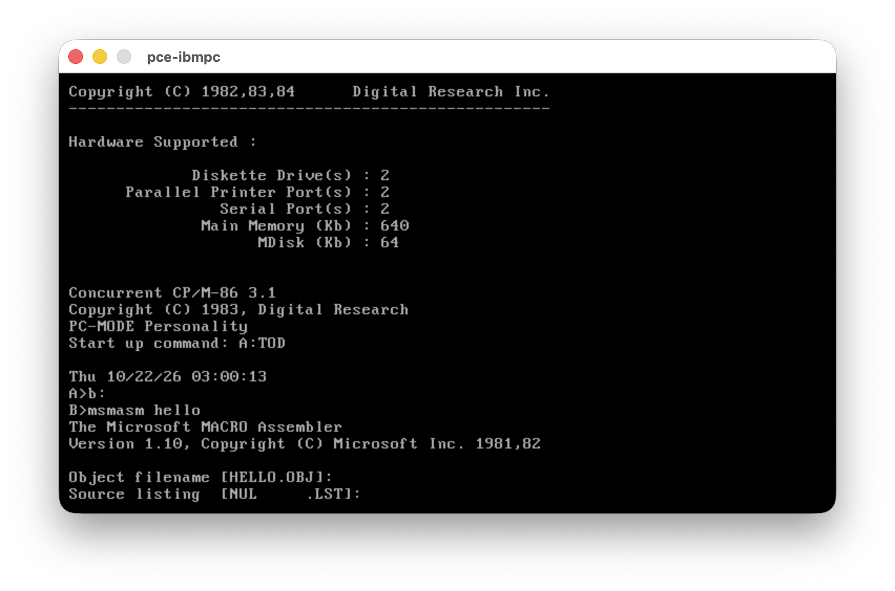

# Concurrent CP/M-86 3.1 Kernel and Tools

**Disk Images are now available as part of the project releases, ready to use !**

This project preserves Digital Research's Concurrent CP/M-86 3.1 as a usable,
rebuildable system for running and exploring classic 16-bit software. Runnable
disks and development tools accompany the sources and patch notes, making the
system more consumable (CP/M-Plus style) and accessible to anyone interested in its history.

## PC-MODE is back — DOS programs on Concurrent CP/M-86!

**The default system now includes PC-MODE: run supported DOS `.COM` and `.EXE`
programs alongside native CP/M-86 `.CMD` commands, from the same shell.**
This brings a major part of the system's heritage into the normal source build
and floppy distribution... with plenty of fixes and patches.

<p align="center">

<br><sub>Microsoft Macro Assembler 1.10 running under PC-MODE in PCE</sub>
</p>

- **A familiar shell:** PCTMP includes command-line editing and recall, `?` help,
  `CLS`, `SYSDISK`, startup scripts and configurable `SETDEF` search order.
- **DOS text applications get all 25 rows.** Returning to the shell restores the
  native 24-row console and status line. DOS/BIOS services connect to the shared XIOS.
- **DOS development tools are included:** MASM, LIB, LINK, LINKCMD, LINKEXE,
  EXE2BIN and Microsoft BASIC have their own `ccpmdos.img` companion disk.
  `BATCH.CMD` is included on the system disks for BAT execution.
- **Two personalities, one build:** `make` produces both the PC-MODE system
  (`ccpm86.img`) and a native TMP alternative (`ccpmnative.img`). Choose at boot.

With the project's `pcfloppy` launcher, boot PC-MODE and mount the DOS tools:

```sh
pcfloppy ccpm86.img ccpmdos.img
```

PC-MODE supports a bounded DOS/BIOS subset; application compatibility varies.
The supplied disks use the CP/M filesystem—DOS FAT support is not enabled.
See [patch notes](patches.md#pc-mode-and-loader-hardening) for the implementation
and verification details, and [distributions](#distributions) for all six disks.

<p align="center">


<br><sub>Concurrent CP/M-86 3.1 &nbsp;·&nbsp; Console windows</sub><br>


<br><sub>System setup &nbsp;·&nbsp; Microsoft BASIC 5.50A</sub>
</p>


| Goal | Distribution |
| --- | --- |
| Full source distribution | Kernel, nine RSPs, most commands; gaps below |
| PC-MODE | DOS COM/EXE execution, PCTMP shell, DOS development disk; native TMP boot alternative |
| Additional tools | ASM80, HEXCOM, DREDIX, DR development chain, Microsoft BASIC 5.50A |
| Y2K components | SDIR, DATE, SHOW, TOD for CCP/M-86 3.2 through Concurrent DOS 4.1; 3.1 fixes included |
| Usability and Bug fixes| CP/M Plus usability, known problem fixes (like the failing sysdisk on systems with 2 floppies and a hard disk) ... |

Alongside PC-MODE, the current version includes:
- CP/M Plus mapped and direction keys command line recall and editing,
- CP/M Plus setdef style configurability
- Support for CGA, EGA modes even on VGA card,
- Y2K compliance,
- CLIs for floppy copy, format and more
- New terminal commands (cls, sysdisk)
- and many other patches ...

These additions make the system easier to use while preserving its native CP/M workflow.

## Command line conveniences

Buffered console input supports cursor movement, insertion, deletion and
recall of the last nonempty line on each console:

| Key | Action |
| --- | --- |
| Left / Ctrl-A | Move one character left |
| Right / Ctrl-F | Move one character right |
| Home / End | Go to the beginning / end |
| Up / Ctrl-W | Recall the last line when empty; otherwise go to the end |
| Backspace / Rubout | Delete left of the cursor |
| Delete / Ctrl-G | Delete at the cursor |
| Ctrl-K / Ctrl-X | Delete to the right / left of the cursor |
| Ctrl-B | Toggle between beginning and end |
| Ctrl-U / Ctrl-R | Cancel the line / retype it on a new line |

Return accepts the whole line from any cursor position. The editor also
serves applications using BDOS Function 10; raw-input applications keep
their own keys. There is one saved line per console, not a history list.

At the shell prompt, `?` lists common commands and `? PIP` opens `HELP PIP`
when HELP is installed. Command errors identify missing commands, unavailable
drives, invalid names, resource limits and malformed executables.

`SETDEF` controls each console's command search path and file order:

| Command | Effect |
| --- | --- |
| `SETDEF` | Show current settings |
| `SETDEF *,A:,C:` | Search the current drive, then A: and C: |
| `SETDEF [ORDER=(CMD,SUB)]` | Search CMD, then SUB on each drive |
| `SETDEF [ORDER=(CMD,DOS)]` | Search CMD, COM, EXE, BAT on each drive (default) |
| `SETDEF [ORDER=(CMD,SUB,DOS)]` | Search CMD, SUB, COM, EXE, BAT on each drive |
| `SETDEF * [ORDER=(CMD)]` | Search only the current drive for CMD commands, then the system fallback |

Resident commands take priority; an explicit drive bypasses the path.
The system disk remains the final fallback. `SYSDISK` selects that disk
globally, while SETDEF settings are local to each console and last until
changed or rebooted. Add SETDEF to `STARTUP.nnn` for persistent preferences.

Automatic SUB execution requires the rebuilt `SUBMIT.CMD` on the search
path. An explicit `.SUB` runs a script even when SUB is absent from the search
order. Native TMP accepts the same settings and ignores DOS entries.
Loading commands from other drives preserves the working drive and user.
See `HELP SETDEF` and [Patches](patches.md) for details and limitations.

## Distributions

| Image | Bootable | Contents |
| --- | --- | --- |
| `ccpm86.img` | Yes | PC-MODE/PCTMP kernel, core commands, ED, full HELP, BATCH, SYSDISK, SETDEF, PIP |
| `ccpmnative.img` | Yes | Native TMP/XIOS alternative, with the same core commands and shared kernel fixes |
| `ccpmtools.img` | No | DREDIX, ASM86, DDT86, GENCMD, GENCCPM, WINDOW/WMENU, sample SUB files, PIP, TOD |
| `ccpmmaint.img` | Yes | PC-MODE kernel, disk maintenance tools, CONFIG, FUNCTION, SETUP, SYSTAT, PIP, TOD |
| `ccpmdev.img` | No | Native DR development/BASIC tools, Microsoft BASIC CMD, ASM80, HEXCOM, GENTAB |
| `ccpmdos.img` | No | DOS MASM, LIB, LINK, LINKCMD, LINKEXE, EXE2BIN and Microsoft BASIC COM |

`make dist` places the images above and `disks.zip` containing all six at the repository root.


Root `make` builds both kernels in one run: `kernel/sysgen/ccpm.sys` (PC-MODE)
and `kernel/sysgen/ccpm-native.sys` (native TMP). The native floppy installs its
kernel as `CCPM.SYS`, as required by the normal boot loader. Both personalities
use the same XIOS implementation and shared kernel fixes. Native XIOS disables
the PC-MODE gateway; this is a source-built alternative, not an archival binary.
Boot either system disk in A: and use the data disks in B:. DOS programs require
the PC-MODE system. Configuration utilities live on maintenance to keep both
system disks within 320 KB.

320 KB: **untwist → cpmtools `ccpm86-320` → twist**.
[Media recipes and emulator usage](media/README.md).
The full HELP is on the main disk; WINDOW and WMENU are on the tools disk.
Window layouts: `CARDDECK.SUB`, `CLEAR.SUB`, `GLASS.SUB` and `WORDPROC.SUB`.
The [source-built boot track](boot/README.md) reproduces all 4,096 bytes of the original.

## Tools

Format: [cpm86-kernel](../cpm86-kernel/README.md). **3.1** = rebuildable sources; SYSDISK: byte-identical CMD plus TMP built-in.

| Tool | Purpose | Binary (`base/`) | Source (`commands/`) | BDOS 2.2 Compat. |
| --- | --- | --- | --- | :---: |
| `asm86` | 8086 assembler | — | 3.1 | ✓ |
| `cls` | Clear the terminal screen | — | TMP built-in; VT52 ESC-E |  |
| `chset` | Inspect or change CMD header flags | — | Recompiled from CCP/M-86 3.1 and adapted |  |
| `config` | Configure serial ports | Original | — |  |
| `date` | Display or set the date | — | Recompiled from CCP/M-86 3.1 and adapted, Y2K patched |  |
| `dcomp` | Compare floppy diskettes | — | Ported from [PC DOS 1.10](https://github.com/tsupplis/pcdos11-hacking) | ✓ |
| `dcopy` | Copy floppy diskettes | — | Ported from [PC DOS 1.10](https://github.com/tsupplis/pcdos11-hacking) | ✓ |
| `ddt86` | Interactive machine-code debugger | — | Recompiled from CCP/M-86 3.1 and adapted | ✓ |
| `dir` | List directory contents | — | Recompiled from CCP/M-86 3.1 and adapted; command/RSP |  |
| `dform` | Command-line floppy formatter | — | New | ✓ |
| `dskmaint` | Format, verify and copy diskettes | Original | Reverse engineered from CCP/M-86 |  |
| `ed` | Line-oriented text editor | — | Recompiled from CCP/M-86 3.1 and adapted | ✓ |
| `era` / `eraq` | Erase files, optionally with confirmation | — | Recompiled from CCP/M-86 3.1 and adapted |  |
| `function` | Program function keys | Original | — |  |
| `gencmd` | Convert H86 output into CMD executables | — | Recompiled from CCP/M-86 3.1 and adapted | ✓ |
| `genccpm` | Generate and configure the system image | — | Recompiled from CCP/M-86 3.1 and adapted; flag-table fix |  |
| `gentab` | Generate disassembler opcode tables | — | Recompiled from CCP/M-86 3.1 and adapted |  |
| `hdmaint` | Hard-disk maintenance | Original | — |  |
| `help` / `help.hlp` | Browse indexed command help | — | Recompiled from CCP/M-86 3.1 and adapted; indexed from `help.dat` | ✓ |
| `initdir` | Enable directory date/time stamps | — | Recompiled from CCP/M-86 3.1 and adapted |  |
| `pcetime` | Synchronize time with the PCE host | Original | — |  |
| `pip` | Copy and transfer files | — | Recompiled from CDOS 4.1 and adapted |  |
| `ren` | Rename files | — | 3.1 |  |
| `sdir` | Detailed, sorted directory listing | — | Recompiled from CCP/M-86 3.1 and adapted, Y2K/DPB/tail fixes |  |
| `set` | Set file and drive attributes | — | Recompiled from CCP/M-86 3.1 and adapted |  |
| `setup` | Customize IBM PC/XT XIOS settings | Original | — |  |
| `show` | Display disk space and drive information | — | Recompiled from CCP/M-86 3.1 and adapted, Y2K patched |  |
| `setdef` | Display/change the per-console command drive list; fixed system fallback | — | New, Source-built `SETDEF.CMD`; local kernel extension |  |
| `submit` | Run batch command files | — | Recompiled from CCP/M-86 3.1 and adapted |  |
| `sysdisk` | Display or change the system drive; TMP built-in and standalone tool | — | TMP built-in + standalone `SYSDISK.CMD` recompiled from CCP/M-86 3.1 and adapted; byte-identical CMD reconstruction |  |
| `systat` | Inspect processes and system resources | — | Recompiled from CCP/M-86 3.1 and adapted |  |
| `tod` | Display or set date and time | — | Recompiled from MP/M-86 2.1 and adapted, Y2K patched |  |
| `type` | Display a text file | — | Recompiled from CCP/M-86 3.1 and adapted |  |
| `window` | Control console windows from commands | Original | — |  |
| `wmenu` | Interactive console-window manager | Original | — |  |
| `vcmode` | Set virtual-console background modes | — | Recompiled from CCP/M-86 3.1 and adapted |  |
| `asm80` | 8080 assembler | — | Translated using XLT86 from CP/M-80 2.2 and adapted | ✓ |
| `hexcom` | Convert Intel HEX to COM binaries | — | HEXCOM 3.00-compatible C from [tpzasm](https://github.com/johnsonjh/tpzasm) | ✓ |
| `dredix` | Full-screen text editor | — | 4.1; DREDIX C Backported from Concurrent DOS 4.1 |  |

✓ = confirmed compatible with BDOS 2.2.

### Development binaries

`dev/` contains imported binaries; guest compatibility is not fully audited.

| Tool | Product | Version | Vendor |
| --- | --- | --- | --- |
| `rasm86.cmd` | Relocating assembler | 1.4 | Digital Research |
| `link86.cmd` | Linkage editor | 2.02 | Digital Research |
| `lib86.cmd` | Library manager | 1.3 | Digital Research |
| `xref86.cmd` | Cross-reference tool | 1.1 | Digital Research |
| `sid86.cmd` | Debugger with 286 disassembler | 2.4 | Digital Research |
| `cbas86.cmd` | CBASIC compiler | 1.4 | Digital Research |
| `crun86.cmd` | CBASIC runtime | 1.4 | Digital Research |
| `pbasic.cmd` | Personal BASIC | 1.2 | Digital Research |
| `mbasic86.cmd` | [BASIC-86 recreation](https://github.com/tsupplis/cpm86-msbasic) | 5.50A | Microsoft lineage |
| `mbas522.cmd` | BASIC-86 reference; archive only | 5.22 | Microsoft |

## Y2K utilities

| Utility | CCP/M-86 3.1 | 3.2 family | Concurrent DOS 4.1 | DOS Plus 1.2 |
| --- | --- | --- | --- | --- |
| SDIR | Fixed | Fixed | Fixed | Fixed |
| DATE | Fixed | Compliant | Compliant | Compliant |
| SHOW | Fixed | Fixed | Compliant | Compliant |
| TOD | Fixed | Fixed | Compliant | Compliant |

Fixed = replacement needed; Compliant = existing utility works.
Audit: CCP/M-86/Concurrent DOS 3.2; boot regressions: 3.1.

## Kernel and RSP patches

[Patches](patches.md): RTC startup/persistence, yellow status, adapter-aware
cursor, EGA/VGA retrace handling, console shortcuts, configured drives,
GENCCPM flag records, PIN and build corrections. CGA graphics modes 4/6 now
use kernel-controlled BIOS mode/palette calls on EGA/VGA, preserving the CGA
path and restoring text. Native EGA mode 10h (640x350, 16 colours) is also
available on EGA with >=128 KB or VGA. Other native EGA modes and a general
application INT 10h layer are not provided. The super annoying sysdisk to B: 
vs C: when 2 floppies are on the system is also fixed...

## Build and checks

Build: [cpm86-crossdev](https://github.com/tsupplis/cpm86-crossdev), make,
cpmtools, Python 3, Git, tar, zip. Emulators: PCE (interactive), QEMU (checks).
The boot build requires native `h862bin` from `cpm86-cmdtools` on PATH.

| Command | Result |
| --- | --- |
| `make` | Commands, kernel/RSPs, boot sources, four images |
| `make -C commands/sysdisk check` | Byte-identical SYSDISK reconstruction |
| `make check` | SYSDISK identity, source-built boot identity, every packaged file, sizes |
| `make check-qemu` | Boot, RTC, status, switching, HELP, SDIR, SYSDISK, SETDEF, DREDIX, windows |
| `make test` | Launch PCE |
| `make dist` | `y2k-dist.zip`, `disks.zip` and the four disk images at the repository root |
| `make source-dist` | Sources and reference/vendor inputs; no ignored outputs |

[Source pedigree](http://www.cpm.z80.de) · [License correspondence](LICENSE.md).

---

## Companion projects

| Project | Description |
|---------|-------------|
| [cpm86-kernel](https://github.com/tsupplis/cpm86-kernel)     | CP/M-86 1.1 distribution rebuilt from patched and reconstituted sources |
| [ccpm86-kernel](https://github.com/tsupplis/ccpm86-kernel)         | CCP/M-86 3.1 distribution rebuilt from patched and reconstituted sources |
| [cpm86-crossdev](https://github.com/tsupplis/cpm86-crossdev) | Unix CP/M-86 cross development project (compilers, emulation and tools) |
| [cpm86-hacking](https://github.com/tsupplis/cpm86-hacking)   | CP/M-86 miscellaneous tools and PCE emulator helpers |
| [cpm86-cmdtools](https://github.com/tsupplis/cpm86-cmdtools) | CP/M-86 `.cmd` file manipulation tools |
| [cpm86-ports](https://github.com/tsupplis/cpm86-ports)       | CP/M-86 application ports in C and assembler |
| [cpm86-vi](https://github.com/tsupplis/cpm86-vi)             | STevie vi port for CP/M-86 and PC-DOS |
| [cpm86-msbasic](https://github.com/tsupplis/cpm86-msbasic)   | A recreaction of msbasic-86 for CP/M-86 and PC-DOS 1.1 from gwbasic sources |
| [cpm86-menu](https://github.com/tsupplis/cpm86-menu)   | A submit replacement and a menu system for submit orchestration for CP/M-86 1.1 |
| [cpm86-make](https://github.com/tsupplis/cpm86-make)   | A simple submit based make tool for CP/M-86 |
| [pcdos11-hacking](https://github.com/tsupplis/pcdos11-hacking) | PC-DOS 1.1 distribution, tools and notes |

--

## License

CP/M-derived material is covered by the [CP/M license](LICENSE.md); other material uses the [MIT license](LICENSE-bis.md), unless specified otherwise in a subdirectory.

