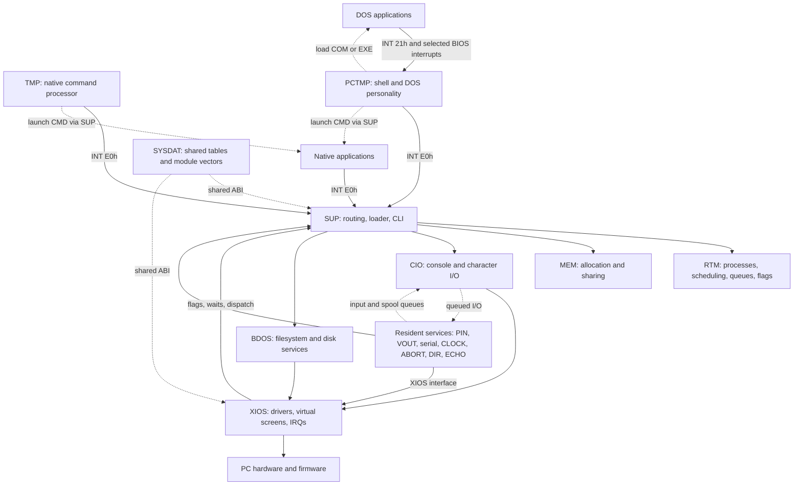
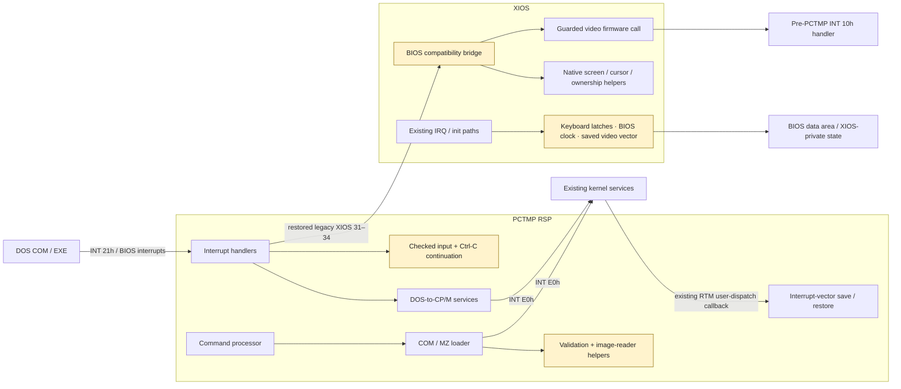
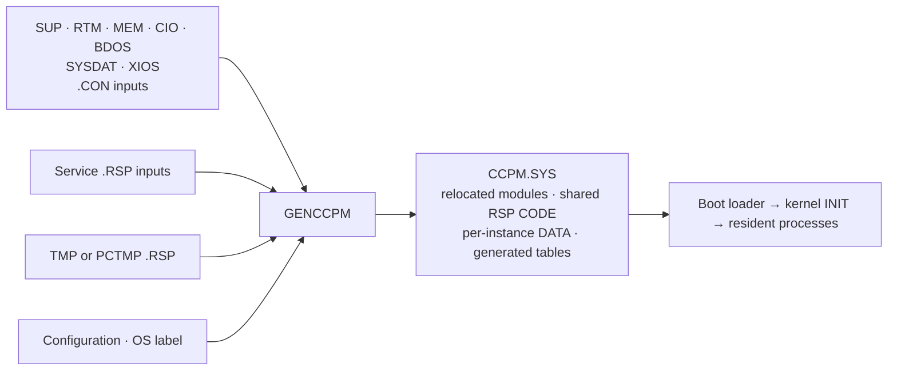

# Kernel architecture

CCP/M-86 3.1, 8086 real mode. Components are build/ABI boundaries, not protected
address spaces. Arrows show principal service dependencies, not an exhaustive call graph.

## Runtime components

TMP and PCTMP are alternatives, one configured command processor per console.
Dotted launch edges show process lifecycle; solid interrupt edges show runtime
service calls. Native applications call the kernel directly, without TMP/PCTMP
forwarding their calls. PCTMP additionally supplies resident DOS handlers, executed
in the calling DOS application's context; INT 21h is not IPC to the shell process.

## Component responsibilities

| Component | Responsibility | Interface / relationship |
| --- | --- | --- |
| Native application | A CP/M/CCP/M program, typically `.CMD`; e.g. ED or ASM86 | Targets the native API through `INT E0h`; launched via SUP's loader/CLI services |
| DOS application | A DOS `.COM` or MZ `.EXE`; e.g. MSMASM or LINK | Loaded by PCTMP; uses its `INT 21h` and supported BIOS emulation |
| TMP | Native prompt, command parsing and built-ins | Requests native command execution from SUP; waits for foreground completion |
| PCTMP | TMP alternative plus DOS loading and resident DOS personality | Launches native commands through SUP; owns the DOS loader, `INT 21h` dispatch and interrupt-vector state |
| SUP | Kernel service entry, routing, loading and CLI services | Receives `INT E0h`; routes calls to the implementing kernel module |
| RTM | Processes, scheduling, queues, flags and synchronization | Manages application lifecycle; invokes the existing user-dispatch callback for PCTMP vector switching |
| MEM | Memory regions, allocation and sharing | Supplies native allocations used by both native loading and PCTMP's DOS loader |
| CIO | Console and character-device semantics | Connects application I/O to XIOS and queue-driven resident services |
| BDOS | FCB filesystem and disk services | Owns native file semantics; PCTMP translates supported DOS requests to these services |
| XIOS | PC device drivers, virtual screens, interrupts and hardware adaptation | Serves kernel/RSP calls; experimental legacy functions 31–34 support PCTMP's BIOS personality |
| SYSDAT | Shared module vectors, descriptors, queues and generated configuration | Common kernel ABI/data; not a separately scheduled service |
| PIN / VOUT | Physical input and switch events / buffered background output | Resident processes using native queues and XIOS; VOUT also manages spool files |
| Other service RSPs | Serial I/O, clock, abort, resident directory/echo services | Scheduled native processes, using kernel services and applicable XIOS interfaces |
| GENCCPM | Offline system composition | Combines CON/RSP inputs, configuration and OS label into `CCPM.SYS` |
| Boot loader | Load and enter the generated system | Transfers control to kernel initialization, which starts resident processes |
| Hardware / firmware | Devices, IRQ sources and BIOS routines | Primarily owned by XIOS; real mode also permits applications to access hardware directly |

`INT E0h` is the native service entry; BDOS is one implementing module behind it.
`INT 21h` is the DOS API entry implemented inside PCTMP, not a second kernel BDOS.
The command prompt may wait while an application runs, but its resident PCTMP
handler code remains available. Built-ins execute in the command processor itself.

## Experimental PC-MODE decomposition

Amber components are additions/adaptations within their owning module. The
RTM callback and PCTMP→XIOS relationship predate this port. Firmware video calls
use the saved vector to avoid `PCTMP → XIOS → INT 10h → PCTMP` recursion.

## System composition

## Integrity assessment — `pc-tail` checkpoint

- Six native `.CON` inputs are byte-identical; XIOS is the changed core module.
  Eight service `.RSP` inputs are unchanged. PCTMP replaces TMP.
- PCTMP's DATA template/stride is unchanged. Its CODE has 49 changed original
  bytes plus 1,408 appended bytes. New mutable CODE state is console-indexed.
- Module responsibilities are retained; internal call graphs intentionally differ.
  Historical implementation equivalence is not claimed.
- Before permanent integration: review shared-CODE state, fixed four-console
  storage, reentrancy/lock contracts, and firmware/BIOS-state lifecycle.

Detailed evidence and review decisions: [PC-MODE module audit](private/pcmode/MODULES.md).
Current validation and remaining work: [PC-MODE status](private/pcmode/STATUS.md).
